
<a href="https://angadtathgir.github.io/wc2026-prediction-model/"></a>

<a href="https://github.com/angadtathgir/wc2026-prediction-model"></a>
<a href="https://github.com/angadtathgir/penn-roboracer-wall-follower"></a>
<a href="https://github.com/angadtathgir/shape-detection"></a>

 

 
